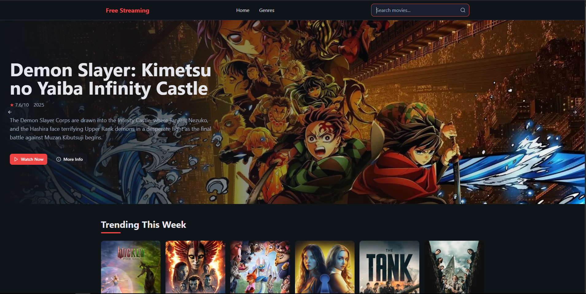
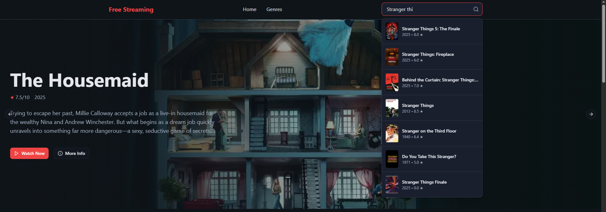
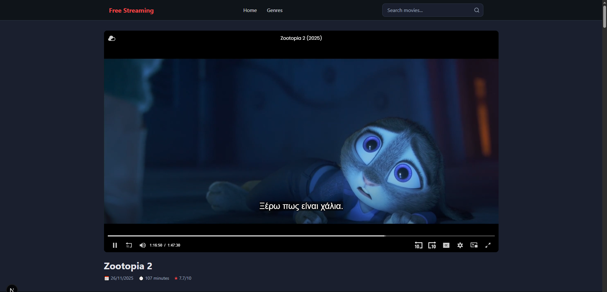
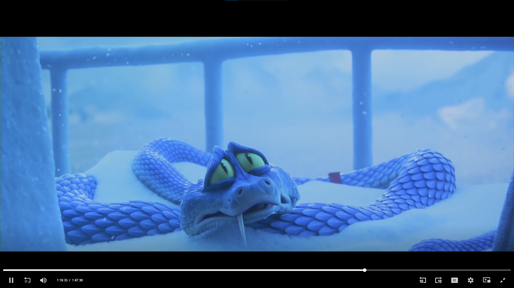

# Movie — Next.js Movie Discovery & Streaming UI

A responsive **Next.js 16, React 19 and TypeScript movie web app** powered by TMDB. Discover trending films, explore genres, search movie titles and view ratings, release dates and related movies in a dark, mobile-friendly interface.

[Getting started](#getting-started) · [Features](#features) · [SEO and deployment](#seo-and-deployment) · [Contributing](#contributing)



## Features

- Trending, popular and newly released movie collections.
- Debounced title search and paginated infinite scrolling.
- Movie detail pages with overview, ratings, runtime and related titles.
- Genre browsing with direct links from movie details.
- Responsive layouts built with Tailwind CSS, shadcn/ui and Radix UI.
- Canonical metadata, social previews, movie JSON-LD, robots.txt and sitemap.xml.
- Optional external video embeds; the application does not host video files.

## Screenshots

| Search suggestions | Search results |
| --- | --- |
|  |  |



## Getting started

Use **Node.js 20.9 or newer** and npm. The committed npm lockfile is the supported reproducible installation path.

```sh
git clone https://github.com/piyushsarkar-dev/movie.git
cd movie
npm ci --include=dev
```

Copy `.env.example` to `.env.local`, then replace `YOUR_API_KEY` with your own TMDB key. On PowerShell:

```powershell
Copy-Item .env.example .env.local
```

On macOS/Linux use `cp .env.example .env.local`.

```sh
npm run dev
```

Open [localhost:3000](http://localhost:3000). Without a valid TMDB key, the app can build but movie collections will be empty.

### Configuration

| Variable | Purpose |
| --- | --- |
| `NEXT_PUBLIC_TMDB_API_KEY` | Your TMDB API key; never commit a real value |
| `NEXT_PUBLIC_TMDB_BASE_URL` | TMDB API origin and version path |
| `NEXT_PUBLIC_TMDB_IMAGE_BASE_URL` | Poster image base URL |
| `NEXT_PUBLIC_TMDB_BACKDROP_BASE_URL` | Backdrop image base URL |
| `NEXT_PUBLIC_VIDSRC_BASE_URL` | External embed provider origin; not a full embed path |
| `NEXT_PUBLIC_SITE_URL` | Your public production origin, such as `https://movies.example.com` |

Use the defaults in `.env.example` for provider URLs. `NEXT_PUBLIC_` values are browser-visible; do not put private credentials in them. `.env.local` is ignored by Git. For private API credentials, move access behind server-only endpoints before deployment.

## Development checks

```sh
npm run lint
npm run typecheck
npm run build
npm start
```

Production builds enforce TypeScript checks. GitHub Actions runs the project checks for pull requests and pushes to main.

## SEO and deployment

1. Import this repository into your Next.js hosting provider and configure the environment variables.
2. Set `NEXT_PUBLIC_SITE_URL` to the real HTTPS production origin, without a path. Rebuild after changing it. Local/unconfigured installations are intentionally not indexable.
3. Verify `/robots.txt`, `/sitemap.xml`, canonical links and social previews on the deployed site.
4. Verify your domain in Google Search Console, submit `/sitemap.xml`, then inspect representative pages. Account/domain verification must be completed by the site owner.
5. Keep movie descriptions useful and accurate. Search and AI recommendation rankings are not guaranteed by metadata or keywords.

The sitemap includes the homepage, genres and the current trending collection; it is not a complete mirror of the TMDB catalogue. Other movie pages can be discovered through normal internal links. Search-result pages use `noindex, follow` to avoid indexing arbitrary queries.

See [Google's SEO starter guide](https://developers.google.com/search/docs/fundamentals/seo-starter-guide) and [Next.js metadata documentation](https://nextjs.org/docs/app/getting-started/metadata-and-og-images).

## Project structure

```text
app/          App Router pages, metadata routes and server actions
components/   Movie grids, search, navigation and reusable UI
lib/          TMDB integration, SEO helpers and utilities
public/       Images and screenshots
```

## Contributing

Open an issue with reproduction steps, expected behaviour and relevant screenshots. Do not include API keys or private logs. For a pull request, describe the user-visible change and run lint, typecheck and build first.

After the security history rewrite, use a fresh clone. Do not merge or push branches from the old history: that can restore previously exposed credentials. Report sensitive issues privately to the maintainer rather than posting credentials in a public issue.

## Data and attribution

Movie metadata and artwork come from [The Movie Database](https://www.themoviedb.org/). This product uses the TMDB API but is not endorsed or certified by TMDB. External playback depends on third-party availability and permissions; no availability, ad-free playback or content rights are guaranteed.

Built by [Piyush Sarkar](https://github.com/piyushsarkar-dev).
